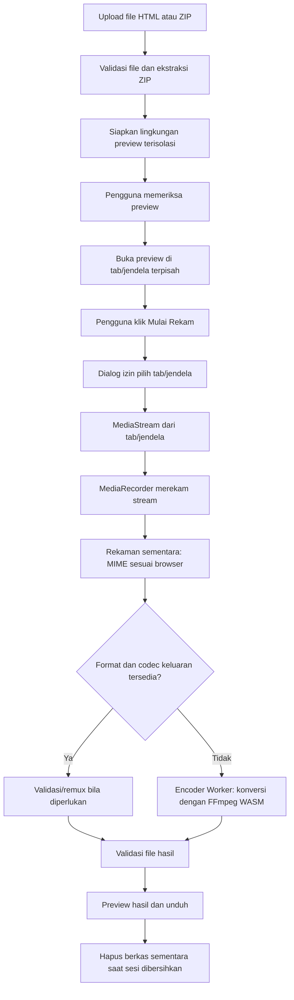

# Arsitektur Proyek HTML to MP4 / MP3 Converter

> Dokumen rancangan teknis awal. Nama produk, identitas visual, dan domain belum ditetapkan. Dokumen ini menjadi acuan implementasi untuk developer.

## 1. Ringkasan proyek

Membangun website converter yang menerima file HTML animasi—secara langsung (`.html`) atau sebagai arsip proyek (`.zip`)—menampilkan preview, merekam hasil tampilannya, lalu memungkinkan pengguna mengunduh hasil sebagai MP4. Jika halaman menghasilkan audio dan browser mengizinkan audio tab untuk ditangkap, pengguna juga dapat mengekspor audio ke MP3.

### Sasaran utama

- Dapat di-deploy ke Vercel.
- Pemrosesan media sebisa mungkin berlangsung di browser pengguna; tidak membutuhkan VPS atau server encoding khusus untuk MVP.
- File sumber dan hasil konversi tidak dikirim ke backend aplikasi.
- Antarmuka responsif, progres proses terlihat, dan error disampaikan dengan jelas.
- Modul perekaman dan encoding dipisahkan agar implementasi dapat dikembangkan tanpa mengubah keseluruhan aplikasi.

### Batasan penting sejak awal

HTML adalah dokumen yang dirender browser, bukan file video. Website biasa tidak memiliki API universal yang bisa mengambil setiap halaman HTML dan langsung mengekspornya menjadi video secara diam-diam. Untuk MVP, gunakan alur perekaman tab/jendela melalui Screen Capture API yang meminta izin pengguna, kemudian konversi hasil rekaman bila format keluaran yang dibutuhkan tidak didukung langsung oleh browser. `getDisplayMedia()` memerlukan konteks aman (HTTPS), interaksi pengguna, serta izin baru untuk setiap sesi; dukungan audio dan pilihan sumber berbeda antar-browser.

Karena itu, fitur ini harus dijelaskan sebagai **preview → rekam tab/jendela dengan izin pengguna → proses/konversi → download**, bukan janji konversi otomatis untuk semua jenis HTML.

## 2. Stack yang direkomendasikan

| Area | Pilihan awal | Keterangan |
|---|---|---|
| Framework | Astro | Cocok untuk website statis dan deployment Vercel. |
| Bahasa | TypeScript | Memeriksa kontrak antar-modul dan mengurangi error saat pengembangan. |
| Styling | Tailwind CSS | UI responsif dan konsisten. |
| UI interaktif | Astro components + client-side TypeScript | Bagian converter di-hydrate di sisi klien; tidak perlu menjadikan semua halaman aplikasi dinamis. |
| Import ZIP | JSZip atau library setara | Membaca `index.html`, aset, dan direktori dari ZIP di browser. Evaluasi ukuran bundle dan keamanan sebelum menetapkan dependency. |
| Perekaman | `navigator.mediaDevices.getDisplayMedia()` + `MediaRecorder` | Meminta pengguna memilih tab/jendela/layar yang berisi preview dan merekam stream. |
| Ekspor MP4/MP3 | Adapter encoder dengan `ffmpeg.wasm` sebagai jalur kompatibilitas awal | Jalankan encoding di Worker. Pastikan build FFmpeg yang dipilih benar-benar memiliki encoder yang dibutuhkan; jangan menganggap semua build mendukung codec yang sama. |
| Alternatif encoding | WebCodecs + library muxing seperti Mediabunny | Dapat menjadi jalur lebih efisien bila encoder/codec tersedia di browser. Wajib ada capability detection dan fallback. |
| Penyimpanan sementara | IndexedDB / object URL di perangkat | Menyimpan berkas sementara untuk preview lintas tab jika diperlukan. Bersihkan setelah sesi selesai. |
| Deployment | Vercel Static Deployment | Hosting halaman dan aset statis; tidak membutuhkan API Functions untuk proses konversi MVP. |

Versi dependency harus dikunci di lockfile dan diperbarui lewat pengujian. Jangan mengandalkan URL CDN pihak ketiga untuk file inti WebAssembly tanpa strategi versi, integrity, dan fallback yang jelas.

## 3. Prinsip arsitektur

1. **Client-side first.** File HTML/ZIP, rekaman, dan hasil akhir diproses pada perangkat pengguna.
2. **No server-side encoding in MVP.** Hindari upload video ke Vercel Functions karena konversi media berat dan dapat terkena limit request body, waktu eksekusi, memori, serta ukuran bundle.
3. **Capability detection.** Cek `getDisplayMedia`, `MediaRecorder`, tipe MIME yang didukung, kemampuan codec, dan keberadaan audio track sebelum memulai.
4. **Explicit permission.** Jangan merekam layar atau audio tanpa tindakan dan persetujuan pengguna.
5. **Isolate untrusted HTML.** HTML yang diunggah dianggap kode tak tepercaya; jangan menjalankannya dengan akses ke origin aplikasi.
6. **Progressive enhancement.** UI harus menjelaskan fitur yang tidak didukung, bukan menggantung atau memberi file berekstensi MP4/MP3 yang sebenarnya bukan format tersebut.
7. **Lazy-load encoder.** Modul WebAssembly yang berat hanya dimuat ketika pengguna mulai mengekspor.

## 4. Diagram alur



Diagram ini menunjukkan alur MVP untuk konten HTML umum. Fitur perekaman mandiri berbasis renderer headless bukan bagian dari versi pertama.

## 5. Modul dan tanggung jawab

### 5.1 Import dan validasi

Tanggung jawab:

- Menerima `.html` dan `.zip`.
- Validasi ekstensi, ukuran compressed, jumlah file, ukuran hasil ekstraksi, dan path arsip.
- Jika ZIP, cari `index.html`; bila tidak ada, tampilkan pilihan file HTML yang ditemukan atau minta pengguna menyiapkan entry point.
- Jangan mengeksekusi file saat validasi berlangsung.
- Tampilkan nama file dan ukuran dengan jelas.
- Tolak arsip dengan path traversal seperti `../`, file yang melewati batas resource, atau struktur arsip yang mencurigakan.

Batas awal yang disarankan dan harus dapat diubah melalui satu konfigurasi:

- HTML tunggal: maksimum 10 MB.
- ZIP: maksimum 25 MB.
- Total hasil ekstraksi: maksimum 100 MB.
- Maksimum file per arsip: 500.

Batas tersebut adalah guardrail produk awal, bukan batas browser universal. Uji pada perangkat spesifikasi rendah dan tampilkan pesan bila sumber melampaui batas.

### 5.2 Runtime preview

- Preview ditempatkan pada route/lingkungan terpisah, contohnya `/preview`, atau iframe sandbox terisolasi.
- Jangan gunakan `allow-scripts` bersama `allow-same-origin` untuk HTML pengguna pada iframe same-origin.
- Jangan memberikan akses top-navigation, popup, form submission, download otomatis, atau izin perangkat kecuali ada alasan yang ditinjau dan disetujui.
- Untuk ZIP, siapkan aset lokal dalam sesi preview dan pertahankan hubungan path relatif sejauh memungkinkan.
- Beri label bahwa resource eksternal mungkin memerlukan internet dan dapat gagal karena CORS, CSP, autentikasi, atau batasan browser.
- Jangan membuka HTML mentah pengguna pada origin utama aplikasi.

**Catatan kompatibilitas:** sandbox yang ketat bisa memengaruhi JavaScript module, `fetch`, service worker, penyimpanan, dan resource lintas origin. Jangan mengklaim semua proyek HTML dapat berjalan identik dengan browser aslinya. Bila dukungan bagi HTML arbitrer yang kompleks menjadi persyaratan utama, pertimbangkan renderer terpisah pada origin khusus atau layanan browser terisolasi sebagai fase lanjutan.

### 5.3 Perekaman tab/jendela

- Minta izin hanya setelah tombol “Mulai Rekam” diklik.
- Instruksikan pengguna memilih tab/jendela yang menampilkan preview, bukan tab kontrol converter.
- Jika capture audio dibutuhkan, minta audio dan beritahu pengguna bahwa dukungan audio tab berbeda antar-browser.
- Periksa bahwa stream memiliki video track untuk MP4 dan audio track untuk MP3.
- Periksa `MediaRecorder.isTypeSupported()` sebelum memilih MIME type; jangan hardcode bahwa MP4 selalu tersedia.
- Rekam per potongan (`dataavailable`) agar status dapat diperbarui dan error ditangani. Akumulasi Blob tetap dapat mengonsumsi banyak memori, sehingga durasi harus dibatasi.
- Tangani `stop`, `error`, pengguna menghentikan sharing dari browser, izin ditolak, tab ditutup, serta capture tanpa track.
- Hentikan semua `MediaStreamTrack` setelah sesi perekaman berakhir.

### 5.4 Ekspor MP4

Urutan strategi:

1. Periksa apakah `MediaRecorder` pada browser dapat merekam ke MIME type MP4 yang sesuai.
2. Jika tidak, rekam dalam format yang didukung, biasanya WebM, lalu transcode ke MP4 di Worker menggunakan build encoder yang sesuai.
3. Jika memakai WebCodecs, periksa dukungan codec melalui API; tambahkan muxer karena WebCodecs tidak dengan sendirinya menulis file MP4.
4. Periksa tipe MIME dan hasil file setelah ekspor. Ekstensi `.mp4` tidak boleh dipasang pada data WebM yang belum dikonversi.
5. Jika jalur konversi MP4 tidak tersedia di perangkat, jelaskan kendala dan tawarkan WebM sebagai opsi alternatif (jika produk mengizinkan), alih-alih menghasilkan file palsu.

Codec MP4 yang diprioritaskan untuk kompatibilitas umum adalah H.264 untuk video dan AAC untuk audio, tetapi dukungan aktual bergantung pada browser dan build encoder. Encoder harus melakukan capability check serta melaporkan error secara eksplisit.

### 5.5 Ekspor MP3

- MP3 hanya mungkin jika rekaman memiliki audio track atau ada sumber audio yang bisa diakses secara sah oleh runtime.
- Untuk audio dari animasi, rekam audio tab/jendela melalui capture yang disetujui pengguna, lalu ekstrak/encode track audio menjadi MP3.
- `getDisplayMedia()` secara teknis meminta video track; alur audio-only dapat mengambil stream tab yang memiliki audio lalu membuang track video setelah diverifikasi. UI harus menjelaskan langkah izin tersebut.
- Audio tab tidak dijamin tersedia di semua browser/OS. Jika track audio tidak ditemukan, tampilkan pesan yang spesifik; jangan membuat file MP3 kosong.
- Pastikan build encoder yang digunakan mendukung MP3, atau sediakan encoder MP3 khusus yang sudah diuji.
- Jika audio tidak terdengar saat preview, periksa apakah halaman memerlukan klik pengguna untuk memulai audio, sesuai aturan autoplay browser.

### 5.6 Worker dan encoder

- Encoding dijalankan di Web Worker melalui wrapper terisolasi; jangan menjalankan loop encoding berat di main thread.
- Muat modul encoder secara dinamis hanya saat dibutuhkan.
- Perbarui progres berdasarkan callback encoder jika tersedia; jika tahap tertentu tidak bisa memberi progres akurat, tampilkan status tahap, bukan persentase palsu.
- Sediakan tombol batal bila proses bisa dihentikan dengan aman.
- Tangani `Out of memory`, core gagal dimuat, codec tidak tersedia, file terpotong, dan encoding timeout.
- Pertimbangkan single-thread WASM terlebih dahulu untuk mengurangi kompleksitas header cross-origin isolation. Multi-thread hanya setelah kebutuhan terukur dan header COOP/COEP diuji.

## 6. Arsitektur route dan struktur folder

Contoh struktur implementasi:

```text
src/
├── components/
│   ├── AppHeader.astro
│   ├── UploadDropzone.astro
│   ├── PreviewPanel.astro
│   ├── RecordingControls.astro
│   ├── ExportSettings.astro
│   ├── ConversionProgress.astro
│   └── ResultPanel.astro
├── layouts/
│   └── BaseLayout.astro
├── pages/
│   ├── index.astro
│   ├── privacy.astro
│   └── preview.astro
├── features/
│   └── converter/
│       ├── types.ts
│       ├── constants.ts
│       ├── validation/
│       │   ├── validate-file.ts
│       │   └── validate-archive.ts
│       ├── import/
│       │   ├── read-html.ts
│       │   └── read-zip.ts
│       ├── preview/
│       │   ├── preview-session.ts
│       │   └── sandbox-policy.ts
│       ├── capture/
│       │   ├── capability-check.ts
│       │   ├── display-capture.ts
│       │   └── media-recorder.ts
│       ├── export/
│       │   ├── export-mp4.ts
│       │   ├── export-mp3.ts
│       │   ├── output-validation.ts
│       │   └── encoder-adapter.ts
│       ├── workers/
│       │   └── encoder.worker.ts
│       └── cleanup/
│           └── release-resources.ts
├── styles/
│   └── global.css
└── env.d.ts
public/
└── media-engine/
    └── (aset core WASM yang dipilih dan diuji)
```

Struktur ini merupakan usulan, bukan kewajiban untuk membuat setiap file pada hari pertama. Pertahankan pemisahan modul berdasarkan tanggung jawab.

## 7. Kontrak data inti

Contoh tipe TypeScript konseptual:

```ts
export type OutputFormat = 'mp4' | 'mp3' | 'webm';

export type ConversionStatus =
  | 'idle'
  | 'validating'
  | 'preparing-preview'
  | 'ready-to-record'
  | 'requesting-permission'
  | 'recording'
  | 'processing'
  | 'completed'
  | 'cancelled'
  | 'error';

export interface ConverterSettings {
  outputFormat: OutputFormat;
  width: number;
  height: number;
  frameRate: 24 | 30 | 60;
  maxDurationSeconds: number;
  includeAudio: boolean;
}

export interface ConversionResult {
  blob: Blob;
  fileName: string;
  mimeType: string;
  durationSeconds?: number;
  sizeBytes: number;
}
```

Nilai resolusi, FPS, dan durasi harus divalidasi dengan daftar preset yang didukung aplikasi. Tipe hasil wajib menyimpan MIME type yang terverifikasi, bukan hanya ekstensi.

## 8. Alur status UI

Status yang disarankan:

`idle → validating → preparing-preview → ready-to-record → requesting-permission → recording → processing → completed`

Status alternatif: `cancelled` dan `error`.

Ketentuan:

- Tombol yang tidak relevan dinonaktifkan selama transisi status.
- Pengguna dapat kembali ke preview sebelum memulai perekaman.
- Saat `recording`, tampilkan durasi real-time, tombol berhenti, dan indikator apakah audio track tersedia.
- Saat `processing`, tampilkan tahap proses yang akurat, misalnya “Menyiapkan encoder”, “Mengonversi video”, atau “Memvalidasi hasil”.
- Setelah selesai, sediakan preview file hasil, ukuran file, durasi bila dapat dihitung, dan tombol unduh.
- Bila browser tidak mendukung jalur MP4/MP3 yang dipilih, jelaskan dukungan yang tidak tersedia dan tampilkan alternatif yang benar-benar dapat dibuat.

## 9. UI dan pengalaman pengguna

Halaman utama disarankan memiliki bagian berikut:

1. Header dan deskripsi singkat fungsi converter.
2. Area drag-and-drop dan tombol pilih file.
3. Daftar file/aset yang berhasil dibaca.
4. Panel preview animasi.
5. Pengaturan ekspor: MP4 atau MP3, resolusi, FPS, durasi, dan audio bila relevan.
6. Panduan memilih tab preview di dialog screen capture.
7. Kontrol mulai/berhenti merekam.
8. Progres, pesan error, hasil, dan tombol download.
9. Catatan privasi: file diproses di perangkat; perekaman layar/tab memerlukan izin pengguna.

Utamakan tampilan desktop pada MVP karena dialog pemilihan tab/window dan beban encoding cenderung lebih nyaman dan lebih dapat diprediksi di desktop. Mobile tetap harus menampilkan pesan kompatibilitas yang jelas.

## 10. Keamanan dan privasi

- Perlakukan HTML, JavaScript, CSS, nama file, dan isi ZIP sebagai input tak tepercaya.
- Jalankan preview di sandbox/isolasi origin. Jangan menyuntikkan HTML unggahan ke DOM utama menggunakan `innerHTML`.
- Jangan gunakan token, cookie, atau data sesi aplikasi pada konteks preview.
- Validasi file berdasarkan ekstensi, ukuran, dan struktur; jangan menganggap ekstensi sebagai bukti bahwa isi file aman.
- Hindari ekstraksi ZIP yang membolehkan path traversal atau ZIP bomb.
- Jangan menyimpan sumber dan hasil di server. Jika memakai IndexedDB, sediakan tombol bersihkan dan hapus data sementara saat sesi selesai atau ketika pengguna memulai proyek baru.
- Lepaskan object URL, stream tracks, Worker, Blob, dan buffer encoder setelah selesai atau saat error.
- Jangan mengirim telemetri berisi isi file atau konten audio/video. Analitik penggunaan—jika ditambahkan—harus minimal dan terdokumentasi.
- Berikan peringatan agar pengguna hanya mengonversi konten yang mereka miliki atau berhak gunakan.
- Terapkan Content Security Policy yang diuji agar tidak mematahkan worker/WASM; jangan memperlonggar CSP secara global hanya demi menjalankan satu dependency.

## 11. Deployment Vercel

### Target MVP

- Build Astro sebagai website statis.
- Vercel menyajikan file HTML/CSS/JS dan aset encoder.
- Tidak ada API route untuk upload file atau encoding.
- Tidak ada database, autentikasi, storage cloud, atau environment secret yang dibutuhkan untuk fitur konversi inti.
- Pastikan berkas `.wasm` dan Worker ikut masuk output deploy dan memiliki MIME type/header yang tepat.
- Gunakan dynamic import untuk modul encoder agar landing page tidak perlu mengunduh keseluruhan engine sebelum pengguna meminta ekspor.

### Mengapa encoding tidak diletakkan pada Vercel Functions?

MVP tidak membutuhkan server untuk proses tersebut. Selain menambah biaya dan kompleksitas, Vercel Functions memiliki batas request body, ukuran bundle, memori, dan durasi yang dapat berbeda menurut runtime/plan. Batas request body 4,5 MB yang didokumentasikan untuk Functions akan menjadi kendala bila video atau ZIP besar dikirim lewat request biasa. Bila suatu saat dibutuhkan rendering otomatis tanpa izin screen capture, perlakukan itu sebagai arsitektur fase lanjutan dengan layanan browser/encoding terpisah dan evaluasi biaya, keamanan, serta batas runtime terlebih dahulu.

### Checklist deployment

- [ ] `npm run build` berjalan tanpa error.
- [ ] Route utama dan route preview dapat diakses di deployment preview.
- [ ] File worker dan WASM dapat dimuat tanpa 404 atau error MIME.
- [ ] CORS/CSP/CORP/COOP/COEP sesuai kebutuhan implementasi dan telah diuji.
- [ ] Encoding diuji di URL HTTPS hasil deploy, bukan hanya localhost.
- [ ] Uji ukuran aset statis terhadap batas Vercel saat ini.
- [ ] Coba tab capture di browser target pada deployment production.
- [ ] Pastikan tidak ada file pengguna yang dikirim ke API/analytics tanpa persetujuan.

## 12. Batasan MVP yang harus disampaikan secara terbuka

- Tidak semua animasi HTML dapat direkam dengan hasil identik pada semua browser.
- Video eksternal, WebGL, font eksternal, CORS, cross-origin iframe, konten DRM, dan resource yang memerlukan login dapat gagal atau tampil berbeda.
- Pengguna harus memilih tab/jendela yang benar pada dialog browser.
- Audio capture bergantung pada browser, sistem operasi, jenis tab, dan pilihan pengguna.
- Codec MP4 dan MP3 tergantung pada kemampuan browser atau build encoder yang disertakan.
- Encoding dapat lambat atau gagal karena RAM/performa perangkat; durasi dan resolusi perlu dibatasi.
- Jika membutuhkan hasil konsisten, batch conversion, rendering tanpa interaksi pengguna, atau dukungan untuk HTML kompleks, diperlukan fase server-side renderer/browser terisolasi—bukan ditambahkan diam-diam ke MVP.

## 13. Tahapan implementasi

### Fase 1 — Fondasi UI dan import

- Setup Astro, TypeScript, Tailwind CSS, dan deployment preview Vercel.
- Bangun UI upload, validasi HTML/ZIP, penanganan error, dan preview sandbox.
- Implementasikan cleanup sumber sementara.

### Fase 2 — Screen/tab capture

- Buka preview di konteks yang bisa dipilih pengguna pada dialog capture.
- Implementasikan permission flow, deteksi track video/audio, MediaRecorder, durasi, stop/cancel, dan cleanup.
- Simpan hasil mentah sementara dan tampilkan preview rekaman.

### Fase 3 — Ekspor MP4

- Tambahkan capability detection dan pemilihan MIME.
- Uji encoder dan codec pada browser yang didukung.
- Tambahkan jalur transcode WebM → MP4 bila direct MP4 tidak tersedia.
- Validasi output dan uji pemutaran hasil pada pemutar umum.

### Fase 4 — Ekspor MP3

- Deteksi audio track, tangani kasus tanpa audio, dan proses konversi menjadi MP3.
- Tampilkan pesan jika pengguna tidak mengizinkan audio capture atau browser tidak menyediakan audio track.
- Uji hasil audio, durasi, dan kasus stream hening.

### Fase 5 — Hardening dan rilis

- Pengujian file rusak/oversized/ZIP berbahaya, memory pressure, codec tidak tersedia, izin ditolak, dan tab capture terhenti.
- Optimasi lazy-loading dan UI mobile.
- Tambahkan halaman privasi/bantuan dan dokumentasikan browser yang diuji.
- Rilis setelah seluruh acceptance criteria terpenuhi.

## 14. Acceptance criteria

Versi MVP dianggap siap diuji rilis bila:

- [ ] Pengguna bisa mengimpor HTML tunggal dan ZIP yang memiliki entry point valid.
- [ ] File divalidasi sebelum dijalankan dan preview tidak berada pada origin utama tanpa isolasi.
- [ ] Panduan perekaman menjelaskan pengguna harus memilih tab/jendela preview.
- [ ] Izin capture ditolak/dibatalkan ditangani tanpa crash.
- [ ] Aplikasi memeriksa track media dan MIME/codec sebelum encoding.
- [ ] MP4 hanya diunduh bila output benar-benar MP4 yang valid; fallback ditampilkan dengan jujur.
- [ ] MP3 hanya diunduh bila audio track valid tersedia dan encoding berhasil.
- [ ] Progress dan error terlihat; tidak ada progress palsu yang mengklaim encoding selesai.
- [ ] Semua stream, object URL, Worker, dan buffer sementara dibersihkan.
- [ ] Proyek berhasil build dan berjalan melalui HTTPS di Vercel.
- [ ] Tidak ada file pengguna yang diunggah ke backend dalam alur default.

## 15. Referensi teknis

Referensi resmi untuk implementasi dan validasi kompatibilitas:

- Astro — Deploy ke Vercel: https://docs.astro.build/en/guides/deploy/vercel/
- Vercel — Function limitations: https://vercel.com/docs/functions/limitations
- MDN — Screen Capture API / `getDisplayMedia()`: https://developer.mozilla.org/en-US/docs/Web/API/MediaDevices/getDisplayMedia
- MDN — `MediaRecorder`: https://developer.mozilla.org/en-US/docs/Web/API/MediaRecorder
- MDN — `MediaRecorder.isTypeSupported()`: https://developer.mozilla.org/en-US/docs/Web/API/MediaRecorder/isTypeSupported_static
- MDN — WebCodecs API: https://developer.mozilla.org/en-US/docs/Web/API/WebCodecs_API
- MDN — iframe sandbox: https://developer.mozilla.org/en-US/docs/Web/HTML/Reference/Elements/iframe
- FFmpeg.wasm — Overview: https://ffmpegwasm.netlify.app/docs/overview/
- Mediabunny — Supported formats and codecs: https://mediabunny.dev/guide/supported-formats-and-codecs

---

**Keputusan arsitektur MVP:** deploy website statis di Vercel dan jalankan import, preview, capture, serta encoding di sisi klien. Utamakan flow perekaman tab/jendela yang disetujui pengguna, gunakan deteksi kemampuan browser, dan jangan menjanjikan dukungan universal untuk seluruh HTML sebelum renderer otomatis terisolasi tersedia.
